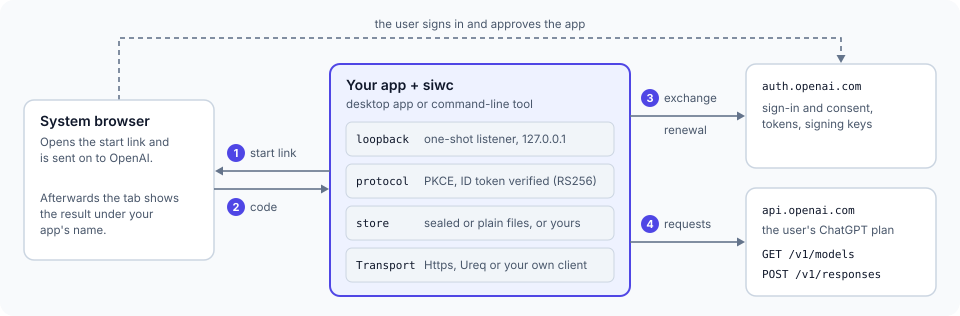

<div align="center">

# siwc

Sign in with ChatGPT for Rust desktop apps and command-line tools.<br>
An independent client library, not affiliated with or endorsed by OpenAI.

[](https://crates.io/crates/siwc)
[](https://docs.rs/siwc)
[](https://github.com/barnerylabs/siwc/actions/workflows/ci.yml)
[](#licence)
[](https://github.com/barnerylabs/siwc/blob/v0.1.0/Cargo.toml)

[API documentation](https://docs.rs/siwc/0.1.0) · [Quick start](#quick-start) · [Transports](#choosing-a-transport) · [Stores](#choosing-a-store) · [Errors](#handling-errors) · [Recipes](#recipes) · [Examples](#examples) · [Changelog](https://github.com/barnerylabs/siwc/blob/v0.1.0/CHANGELOG.md) · [Security policy](https://github.com/barnerylabs/siwc/blob/v0.1.0/SECURITY.md)

</div>

`siwc` signs a user in with their ChatGPT account through the system browser
and then sends API requests that count against that user's ChatGPT plan;
this README calls them plan requests. It is made for desktop apps and
command-line tools that run on the user's own machine. The program talks to
OpenAI directly: there is no backend to run, no API key to paste and no
separate API billing. You need no OAuth client ID either, because OpenAI
issues one at sign-in. OpenAI runs plan requests as a preview and decides
which apps and accounts may send them; see
[Relationship to OpenAI](#relationship-to-openai).

## Quick start

```toml
[dependencies]
siwc = { version = "0.1", features = ["https", "keychain"] }
```

`https` adds a TLS transport and `keychain` a store whose key lives in the
OS keychain; the sections on [transports](#choosing-a-transport) and
[stores](#choosing-a-store) list the alternatives, and
[feature flags](#feature-flags) lists every feature.

```rust,no_run
use std::io::Write;
use std::time::Duration;

use siwc::plan::ResponseRequest;
use siwc::store::Keychain;
use siwc::{AccountState, AppName, Client, ErrorKind, Https};

fn main() -> Result<(), Box<dyn std::error::Error>> {
    // Your app's keychain service name and its folder for the sealed files.
    let store = Keychain::open_sealed("com.example.commit-helper", "commit-helper")?;
    // The name the user reads on OpenAI's consent screen.
    let client = Client::new(AppName::new("Commit Helper")?, store, Https::new()?);

    let account = match client.selected_account()? {
        Some(account) if account.state() == AccountState::SignedIn => account,
        // The first run, or the stored session has ended: sign in.
        stored => {
            let (sign_in, again) = match stored {
                // The user removed the app in ChatGPT: add the account anew.
                Some(account) if account.state() == AccountState::RegistrationRejected => {
                    drop(client.forget(account.id())?);
                    (client.add_account()?, None)
                }
                Some(account) => (client.sign_in_again(account.id())?, Some(account)),
                None => (client.add_account()?, None),
            };
            if sign_in.open_browser().is_err() {
                println!("Open this link to sign in: {}", sign_in.start_link());
            }
            let finished = sign_in.finish(Duration::from_secs(300));
            if let (Err(error), Some(account)) = (&finished, &again) {
                // OpenAI no longer accepts this account's registration: forget
                // it, so the next run adds it anew.
                if error.kind() == ErrorKind::ClientRejected {
                    drop(client.forget(account.id())?);
                }
            }
            let account = finished?.into_account();
            let who = account.identity();
            println!("Signed in as {}", who.email().or(who.name()).unwrap_or("(no e-mail or name)"));
            client.select_account(Some(account.id()))?;
            account
        }
    };

    let models = client.models(account.id())?;
    let model = models.iter().next().ok_or("the plan lists no models")?;
    let prompt = "Write a one-line commit message for: fix a typo in the README";
    let request = ResponseRequest::text(model.id(), prompt)?;
    for event in client.stream_response(account.id(), &request)? {
        if let Some(text) = event?.text_delta() {
            print!("{text}");
            std::io::stdout().flush()?;
        }
    }
    println!();
    Ok(())
}
```

On the first run the browser opens OpenAI's sign-in page, the user approves
"Commit Helper", and the tab says that the sign-in worked. The program prints
who signed in and then the answer as the model writes it. Later runs find the
account in the store and go straight to the request. The loop ends without an
error only when the answer is complete; every other ending is an `Err` as
the last item.

OpenAI's interface guidelines ask for specific labels, such as "Continue
with ChatGPT" on the sign-in button; `plan::wording` has them as constants.

[`examples/quickstart.rs`](https://github.com/barnerylabs/siwc/blob/v0.1.0/crates/siwc/examples/quickstart.rs)
extends this program: it resumes a registration that an earlier run left
unfinished, checks that the account allows plan use before sending, and
explains a usage limit, missing plan use and an ended session in words the
user can act on; other errors print as they are. Run it from a clone of the
repository:

```sh
cargo run -p siwc --features https,keychain --example quickstart
```

## How it works



1. `add_account` binds a one-shot listener on `127.0.0.1` and returns a
   local start link. The browser opens it and is redirected to OpenAI with
   a PKCE challenge and a fresh `state` and `nonce`; `add_account` also
   sends the app's name and, unless `ClientBuilder::send_host_id(false)`
   turns it off, the installation's host ID.
2. After the user approves, the browser returns to the listener with an
   authorization code. After `add_account`, OpenAI has registered the app
   anew, even for a ChatGPT account that is already stored, and the
   callback also carries the new client ID; `sign_in_again` and token
   renewal reuse the client ID stored for the account. The app holds no
   client secret.
3. `siwc` exchanges the code and checks the ID token: its RS256 signature
   against OpenAI's published keys, its issuer, audience, nonce and expiry
   against what this sign-in expects. It stores the account, and only then
   tells the browser tab that the sign-in worked.
4. Each plan request carries the account's access token and goes to
   `api.openai.com`. When a call needs a token that is close to expiry,
   `siwc` renews it first; no timer renews tokens in the background.

A refresh token works once, so renewal runs under a per-account lock that
also holds across processes sharing a store. Two instances of your program,
or your CLI beside your desktop app, never spend the same one at the same
time.

`stream_response` sends a `/v1/responses` request with `"store": false` and
`"stream": true`. Until the API accepts it, the client renews a refused
token once and waits out a busy API a bounded number of times; once a `2xx`
arrives nothing is sent again, even if the answer fails before any text,
because the request may already count against the plan. The
[`stream_response` documentation](https://docs.rs/siwc/0.1.0/siwc/struct.Client.html#method.stream_response)
has the exact rule. To stop a request from another thread, pass a
`Canceller` to `stream_response_cancellable`,
`stream_response_async_cancellable`, `call_cancellable` or
`call_async_cancellable` and trigger it.

A store holds up to 32 accounts side by side, however many clients open
it. Every call names its account and never falls back to another.
`sign_out` ends an account's session and keeps it for `sign_in_again`;
`forget` also removes it from the store. Neither removes the app's
registration from the user's ChatGPT settings, where each `add_account`
leaves an entry: `SignOut::registered_as` gives the name to look for.

## Choosing a transport

`Client` sends every request through a `Transport`. Two come with the crate,
each behind an optional feature that is off by default, and the trait is
small enough to put your own HTTP client behind it.

| Your app | Use | What you get |
| --- | --- | --- |
| has no HTTP client | `Https::new()?`, feature `https` | HTTP/1.1 written in this crate over `rustls`: TLS 1.3 only, one deadline per exchange, prompt cancellation ([limits](#limits)), no log output of its own. |
| prefers an established HTTP client | `Ureq::new()?`, feature `ureq` | [ureq](https://crates.io/crates/ureq) 3.5 over `rustls`: TLS 1.2 or 1.3, ureq's timeouts per phase, slower cancellation ([limits](#limits)). |
| has a blocking HTTP client, such as `reqwest::blocking` | your own `Transport` | 30 to 50 lines: [recipe](#your-own-http-client), which also says when to implement `send_streaming`. |
| has an async HTTP client | a built-in transport for sign-in and renewal, your client for plan requests | `Client::call_async`: [recipe](#your-own-http-client). |

Both built-in transports reach only `auth.openai.com` and `api.openai.com`,
follow no redirect and open a new connection per request. They use a
`CONNECT` proxy only when you configure one, never one from the environment,
and trust the Mozilla roots compiled into the build plus any PEM roots you
add ([proxies and root CAs](#corporate-proxies-and-custom-root-cas)).

With `Ureq`, never turn on `DEBUG` or `TRACE` logging for the `ureq` and
`ureq_proto` log targets while real accounts are in use: at `TRACE` those
crates write whole requests and responses, tokens included. `Https` makes no
logging calls of its own, but the `ureq` feature turns on rustls's `logging`
feature, so with both features on, an app that enables the `rustls` log
targets also gets TLS diagnostics for `Https` connections, without key
material or plaintext. The
[`Ureq` documentation](https://docs.rs/siwc/0.1.0/siwc/ureq/struct.Ureq.html)
lists every difference.

## Choosing a store

| Store | Where the tokens are | Made for |
| --- | --- | --- |
| `Keychain::open_sealed(service, app_dir)`, feature `keychain` | Files in the user's app-data folder, encrypted with ChaCha20-Poly1305; the 32-byte key is in the OS keychain | Desktop apps |
| `PrivateFiles::open_app_dir(app_dir)` | Plain files in the user's app-data folder, with owner-only mode bits on Unix; access control lists are not checked ([details](#headless-servers-containers-and-ssh)) | Servers, containers and SSH sessions without a keychain |
| `MemoryStore::new()` | In process memory | Tests and sessions that end with the process |
| your own `Store` or `SealingKey` | Wherever you keep them | A vault or a native keychain binding; `store::conformance::check` (feature `testing`) tests a `Store` |

What `Keychain` needs on each platform:

| Platform | Keychain | Requirement |
| --- | --- | --- |
| macOS | The user's default keychain, through `/usr/bin/security` | An unlocked keychain, as in a desktop session. Over SSH it is usually locked, and the call fails without a prompt. |
| Linux | Secret Service (GNOME Keyring, KWallet), through `secret-tool` | `secret-tool` from libsecret on `PATH` and an unlocked Secret Service. |
| Windows | Credential Manager, as a generic credential that does not roam | Nothing to install. |

On macOS and Linux, `Keychain` runs the system's own command-line tools
instead of linking a keychain library, so it needs no `unsafe` code. On
macOS the keychain item trusts Apple's `security` program rather than your
app's binary, so a rebuilt or updated app reads its key without a new
prompt. On Linux the tools spare the crate a D-Bus dependency. The key goes
to the tools on standard input, never on a command line. On Windows,
`Keychain` reaches the Credential Manager through
`windows-native-keyring-store`. An app that cannot rely on these tools
implements `SealingKey` over its own keychain binding and passes it to
`store::Sealed`.

The files are in `~/Library/Application Support` on macOS, `%LOCALAPPDATA%`
on Windows and `$XDG_DATA_HOME` (or `~/.local/share`) elsewhere. A GUI and
a CLI that share accounts must open the same directory and the same keychain
service. When their launch environments differ, give both the same explicit
path and seal it the same way:

```rust,no_run
use siwc::store::{Keychain, PrivateFiles, Sealed};

fn shared_store(dir: &std::path::Path) -> Result<Sealed<PrivateFiles, Keychain>, siwc::Error> {
    let files = PrivateFiles::open(dir)?;
    let key = Keychain::new("com.example.commit-helper", &files)?;
    Ok(Sealed::new(files, key))
}
```

A locked keychain makes calls fail with `Store`, and a key missing from the
keychain with `SealingKeyMissing`; unlock or restore the keychain and try
again. `Keychain::start_over` deletes the sealed entries that no key opens,
so call it only as a last resort and only after the user agrees to lose
them.

A store written by a newer release fails with `StoreUnsupported`; open it
with that release again.

## Handling errors

Every fallible call returns `siwc::Error`, except `Client::call` and its
variants, which return your own error type built from it
(`E: From<siwc::Error>`). The error's `kind()` says what the app can do:

| `ErrorKind` | What to do |
| --- | --- |
| `SignInRequired` | The account is signed out or its session ended. Offer `client.sign_in_again(account.id())`. |
| `PlanUseNotGranted` | The user signed in without allowing plan requests. Offer `client.enable_plan_use(account.id())`. |
| `UsageLimit` | Stop sending plan requests for that account and show a "Manage usage" link (`plan::wording::MANAGE_USAGE`) to `plan::MANAGE_USAGE_URL`. |
| `NotPermitted` | The user, the workspace or a policy does not allow plan requests. Explain it; a new sign-in does not help. |
| `ClientRejected` | OpenAI no longer accepts the app's registration for this account, for example because the user removed the app in their ChatGPT settings. `sign_in_again` cannot help: `forget` the account and add it again with `add_account`. Only the token endpoint's answer moves the account to `AccountState::RegistrationRejected`; the same refusal in a sign-in's browser callback changes nothing stored. |
| `AccessDenied` | The user declined the sign-in in the browser. Unlike `ClientRejected`, this says nothing about the app's registration. |
| `Temporary` | The network or OpenAI is unavailable for now. Sign-in, token renewal and the model list can be tried again later. Do not resend a plan request on your own: the client already sent it again where that was safe, and the API may already have accepted it. |
| `Rejected` | The API refused the request itself, for example for a member the plan route does not support, which `param()` names. Change the request; sending it unchanged does not help. |
| `Incomplete` | The model stopped the answer early, at an output limit or a content filter; `provider_code()` says which. Text the stream already handed out is usable, but `into_text` drops it and returns only the error. The same request is likely to stop at the same place. |
| `TimedOut` | Nobody finished the sign-in in the browser before the timeout given to `finish`. |
| `Cancelled` | The app cancelled the operation through a `Canceller`. |

`ErrorKind` is `#[non_exhaustive]`, so a `match` on it needs a wildcard arm.
Branch on `kind()` and `http_status()`, never on the message: its wording
may change. `Display` and `Debug` also redact provider text. When the crate
knows why a connection failed, such as a timeout or invalid HTTP framing,
`cause()` returns it as an `ErrorCause`, and `source()` returns the same
value; it contains nothing from the provider and is safe to log.
`provider_code()`, `request_id()` and `param()` return identifiers the
provider chose, so review them before you share them. The
[`Error` documentation](https://docs.rs/siwc/0.1.0/siwc/struct.Error.html)
covers the other accessors, such as `state_saved()` and `retry_after()`,
and the
[`ErrorKind` documentation](https://docs.rs/siwc/0.1.0/siwc/enum.ErrorKind.html)
has every kind.

## Recipes

### Requests beyond plain text

`ResponseRequest::text` builds a request with one user message,
`ResponseRequest::text_with_instructions` adds the app's instructions, and
`stream_response` sends either. For tools, images or earlier turns, write
the Responses JSON body yourself and pass it to
`ResponseRequest::from_json`. `siwc` decodes text deltas and how the answer
ended; `ResponseEvent::json` hands out every other event, such as a tool
call or the usage, as JSON. `ResponseStream::into_text` returns the whole
answer at once.

### Async on any executor

The `*_async` methods of `Client`, and `SignIn::finish_async`, return plain
`std::future::Future`s that need no particular runtime. They are `Send`;
`call_async`'s future is `Send` when your closure and the future it returns
are. Their blocking work runs on a thread of its own, so an executor thread
never waits for a file lock, the browser or a token refresh. The futures can
borrow the client and the account ID; for an executor that requires a
`'static` task, move an owned client and ID into the task and call the
method there.

Every other `Client` method blocks its thread, among them `add_account`,
`sign_in_again`, `enable_plan_use`, `accounts`, `select_account`,
`export_account_to` and `import_account`. On an executor, wrap such a call
in `siwc::background::run(move || ...)`, which runs it on a thread of its
own and returns a future of its result.

```rust,no_run
use siwc::plan::ResponseRequest;
use siwc::{AccountId, Client, Error};

async fn ask(client: &Client, account: &AccountId, model: &str, prompt: &str) -> Result<String, Error> {
    let request = ResponseRequest::text(model, prompt)?;
    let stream = client.stream_response_async(account, &request).await?;
    // `stream.next().await` would hand out the pieces as they arrive.
    stream.into_text().await
}
```

Dropping the future or the stream cancels the request, and
`stream_response_async_cancellable` also takes a `Canceller`. For a
`futures::Stream`, wrap `poll_next`:
`futures::stream::poll_fn(move |context| stream.poll_next(context))`.

Each open `AsyncResponseStream` holds one thread until it ends, and each
other `*_async` call holds one while it runs. By default that is a new OS
thread every time, which suits an app with a handful of requests at a time.
An app on a runtime hands the work to the runtime's pool for blocking calls
instead, which reuses threads and limits their number:

```rust,ignore
let client = Client::builder(app, store, transport)
    .spawner(|job| drop(tokio::task::spawn_blocking(job)))
    .build();
```

If your app runs more concurrent streams than that pool has threads, send
the plan requests with your own async client
([your own HTTP client](#your-own-http-client)).

### Your own HTTP client

Implement `Transport` over the HTTP client your app already configures, and
sign-in, renewal, the model list and `stream_response` all go through it.
The trait has one required method:

```rust
use siwc::protocol::{HttpRequest, HttpResponse};
use siwc::{Error, Transport};

/// What the app's HTTP client returned.
struct Answer {
    status: u16,
    request_id: Option<String>,  // the `x-request-id` header
    retry_after: Option<String>, // the `retry-after` header
    body: Vec<u8>,
}

#[derive(Debug)]
struct MyHttp;

impl MyHttp {
    /// One request with the app's client: certificate verified, no redirect
    /// followed, a deadline, and a body of at most 1 MiB.
    fn exchange(&self, _method: &str, _url: &str, _headers: &[(&str, &str)], _body: &[u8]) -> std::io::Result<Answer> {
        unimplemented!()
    }
}

impl Transport for MyHttp {
    fn send(&self, request: &HttpRequest) -> Result<HttpResponse, Error> {
        let headers: Vec<_> = request.headers().collect();
        let answer = self
            .exchange(request.method().as_str(), request.url(), &headers, request.body())
            // No answer arrived; the client reports it as temporary.
            .map_err(|_| Error::transport_unavailable())?;
        if !(100..=599).contains(&answer.status) {
            return Err(Error::transport_unavailable());
        }
        // Return refusals so the client can read their status and body.
        Ok(HttpResponse::new(answer.status, answer.body)
            .with_request_id(answer.request_id.as_deref())
            .with_retry_after(answer.retry_after.as_deref()))
    }
}
```

The client must be a blocking one, such as `reqwest::blocking::Client` with
`redirect(Policy::none())` and a timeout; the `*_async` methods call the
transport from their own thread, never from an executor. Keep requests and
responses out of your logs: they hold tokens.

With `send` alone, `stream_response` gets each answer through `send`: it
arrives in one piece once the model has finished, and only if it finishes
within your client's deadline and fits its body limit. A 30-second timeout
or a 1 MiB cap cuts off a long answer. Implement
[`Transport::send_streaming`](https://docs.rs/siwc/0.1.0/siwc/trait.Transport.html#method.send_streaming)
to hand over the body as it arrives: the deadline then ends with the
response head, and the body has no length limit.

An app with an async client can instead keep `Https` or `Ureq` for sign-in
and renewal and send only the plan requests itself, inside
`Client::call_async`: the closure gets the access token, and the client
renews a rejected token once and retries temporary refusals. The
[`plan` documentation](https://docs.rs/siwc/0.1.0/siwc/plan/index.html#with-an-http-client-of-your-own)
walks through it with `SseDecoder`.

### Headless servers, containers and SSH

Without a desktop keychain or a local browser, keep accounts in plain files
with `PrivateFiles::open_app_dir("my-cli")`. The tokens are not encrypted.
On Unix the files are created owner-only (`0700` and `0600`), and the store
refuses a directory or file that belongs to another user or whose mode bits
let other users in. Access control lists are not checked, which matters on
macOS and Windows; `open_app_dir` uses the user's own data folder, whose
default permissions keep other users out. Then sign in one of three ways:

1. Forward a port: bind a fixed one with
   `ClientBuilder::callback_port(53124)`, connect with
   `ssh -L 53124:127.0.0.1:53124 host`, print `sign_in.start_link()` and
   open it in the browser on your own machine.
2. Paste the redirect: call `client.add_account_manually()` and print
   `sign_in.authorization_link()`. After the sign-in the browser is sent to
   an `http://127.0.0.1:...` address that fails to load. The user copies it
   from the address bar, and the app passes it to `sign_in.finish(&pasted)`.
   A program listening on that port on the browser's machine would see the
   authorization code, which is useless without the PKCE verifier that stays
   in your app.
3. Move a signed-in account: on the laptop,
   `client.export_account_to(id, passphrase, path)` writes a
   passphrase-sealed bundle and then signs the account out locally without
   revoking the session. On the server,
   `client.import_account(&bundle_bytes, passphrase)` stores it. The
   refresh token works once, so the session is moved, not copied.

### Offline tests

Add `siwc = { version = "0.1", features = ["testing"] }` to
`[dev-dependencies]` to test sign-in, token expiry, rotation and API refusals
in milliseconds, without network access or real accounts. The browser sign-in
still runs over a `127.0.0.1` socket, `FakeClock` replaces real waits, and
`FakeResponse` scripts the answers of `/v1/responses`. The example is a
`main` so that it runs on its own; in a test file, put its body into a
`#[test]` function that returns `Result<(), siwc::Error>`:

```rust
use std::time::Duration;
use siwc::plan::ResponseRequest;
use siwc::store::MemoryStore;
use siwc::testing::{FakeClock, FakeProvider, FakeResponse, FakeUser};
use siwc::{AppName, Client, UnixTime};

fn main() -> Result<(), siwc::Error> {
    let clock = FakeClock::new(UnixTime::from_secs(1_800_000_000));
    let provider = FakeProvider::with_clock(&clock);
    let client = Client::builder(
        AppName::new("Commit Helper")?,
        MemoryStore::new(),
        provider.transport(),
    )
    .clock(clock.clone())
    .build();

    let sign_in = client.add_account()?;
    provider.approve(&sign_in, FakeUser::new("alex@example.invalid"));
    let account = sign_in.finish(Duration::from_secs(5))?.into_account();

    clock.advance(Duration::from_secs(3600));
    let _renewed = client.access_token(account.id())?;

    provider.push_response(FakeResponse::text(&["fix: ", "correct a typo"]));
    let request = ResponseRequest::text("example-large", "Write a commit message.")?;
    let answer = client.stream_response(account.id(), &request)?.into_text()?;
    assert_eq!(answer, "fix: correct a typo");
    Ok(())
}
```

### Corporate proxies and custom root CAs

Neither built-in transport reads proxy environment variables. Configure PEM
roots and an `http://` or `https://` forward `CONNECT` proxy explicitly.
Inside the tunnel the transport still verifies TLS to `auth.openai.com` and
`api.openai.com`, against the bundled roots and the roots added here.

A root you add is trusted for those two hosts as well. If it belongs to a
TLS-inspecting proxy, that proxy can read all traffic through it, tokens
included.

`Https` uses TLS 1.3 for every connection, including the one to an
`https://` proxy and the one a TLS-inspecting proxy terminates. Behind a
proxy that offers only TLS 1.2, use `Ureq`. Both transports refuse a proxy
URL with credentials (`user:pass@`), so they cannot use a proxy that asks
for a password.

```rust,no_run
fn enterprise_transport() -> Result<siwc::Https, Box<dyn std::error::Error>> {
    let ca_pem = std::fs::read("/etc/ssl/certs/corp-root-ca.pem")?;
    Ok(siwc::Https::builder()
        .add_root_certificates_pem(&ca_pem)?
        .proxy("https://proxy.corp.example:8443")?
        .build()?)
}
```

`Ureq::builder()` has the same two methods.

## Feature flags

No Cargo feature is on by default. The default build has four direct
dependencies (`ring`, `serde_core`, `serde_json`, `zeroize`) and 11
packages in all, chooses no async runtime and is `#![forbid(unsafe_code)]`.
Package counts are for Linux, from `cargo tree -e normal`.

| Feature | Adds | Packages |
| --- | --- | --- |
| `https` | `Https` and `HttpsBuilder`: blocking TLS 1.3 transport for sign-in, token renewal, the model list and streamed plan requests, with optional PEM roots and a `CONNECT` proxy | 6 (`rustls`, `webpki-roots` and their dependencies) |
| `ureq` | `Ureq` and `UreqBuilder`: the same requests through ureq 3.5 | 16 (`ureq`, `rustls`, both root lists and their dependencies) |
| `keychain` | `store::Keychain`: the sealing key in the macOS keychain, the Linux Secret Service or the Windows Credential Manager | none on macOS and Linux; 6 on Windows (`keyring-core`, `windows-native-keyring-store` and their dependencies) |
| `testing` | `testing::{FakeProvider, FakeClock, FakeUser, FakeResponse}`, `store::conformance::check` and the `Entropy` trait for fixed randomness, for `[dev-dependencies]` | none |

`https` and `ureq` can be on together.

## Examples

Runnable programs in [`crates/siwc/examples/`](https://github.com/barnerylabs/siwc/tree/v0.1.0/crates/siwc/examples);
each file's header shows how to run it:

| Example | Features | What it shows |
| --- | --- | --- |
| [`quickstart.rs`](https://github.com/barnerylabs/siwc/blob/v0.1.0/crates/siwc/examples/quickstart.rs) | `https`, `keychain` | The quick start program, extended to resume an unfinished registration, check plan use before sending, and explain a usage limit, missing plan use and an ended session. Start here. |
| [`keychain.rs`](https://github.com/barnerylabs/siwc/blob/v0.1.0/crates/siwc/examples/keychain.rs) | `https`, `keychain` | The shortest sign-in with `Keychain::open_sealed`, without plan requests. |
| [`desktop.rs`](https://github.com/barnerylabs/siwc/blob/v0.1.0/crates/siwc/examples/desktop.rs) | `https`, `keychain` | A UI event loop that never blocks: worker threads, `Canceller` and `Changes` polling. |
| [`sign_in.rs`](https://github.com/barnerylabs/siwc/blob/v0.1.0/crates/siwc/examples/sign_in.rs) | `https` | A complete CLI: `--port`, `--proxy`, `--ca-cert`, manual sign-in, account export and import, `diagnose`. |
| [`keychain_store.rs`](https://github.com/barnerylabs/siwc/blob/v0.1.0/crates/siwc/examples/keychain_store.rs) | `https`, `testing` | How to write a `Store` of your own and test it with `store::conformance::check`, here over the OS keychain's command-line tools. A demonstration, not a store to ship; its header lists its limits. |

## Security

Sign-in is the authorization code flow with S256 PKCE, `state` and `nonce`.
The listener binds `127.0.0.1` only and answers one attempt, and the ID
token is verified before an account exists.

Tokens never appear in `Debug` output, error messages, command lines or the
environment, and the crate's own code logs nothing. Token buffers are wiped
when dropped.

There is no telemetry and no request your app did not trigger; the hosts
the built-in transports reach are listed under
[choosing a transport](#choosing-a-transport).

cargo-fuzz targets in
[`fuzz/`](https://github.com/barnerylabs/siwc/tree/v0.1.0/fuzz) cover the
callback, token, key-set, HTTP, SSE, sealed-entry and account-bundle
parsers.

`siwc` does not protect against software that runs as the same OS user:
such software can read the user's files and keychain.
[`SECURITY.md`](https://github.com/barnerylabs/siwc/blob/v0.1.0/SECURITY.md)
has the scope, the known limits and how to report a vulnerability.

## Limits

- Only plain-text requests and events are typed, because the fields that
  plan requests accept still change during OpenAI's preview. Anything else
  is JSON ([requests beyond plain text](#requests-beyond-plain-text)).
- A streamed event larger than 16 MiB ends the stream with
  `InvalidResponse`. The closing `response.completed` event repeats the
  whole output, so a complete answer is limited to somewhat less than
  16 MiB of text, whether the app iterates over the stream or calls
  `into_text`.
- A stream that sends nothing for 5 minutes fails with `Temporary`
  (`stream_idle_timeout` on either builder). With `Https`, a `Canceller`
  stops a request within about 50 ms, except during a TCP connect, which can
  take up to `connect_timeout` (10 s by default). `Ureq` checks for a
  cancellation before it connects and then not again until the response
  head arrives; during a stalled body read it notices only once that read
  times out.
- `open_browser` puts the start link on a command line, where other local
  users can read it on Linux and macOS while the sign-in waits. To avoid it,
  show `start_link()` for the user to copy. Whoever opens the link first can
  finish `add_account` with their own ChatGPT account, so show which
  identity signed in, as the quick start does; `sign_in_again` refuses a
  different user with `AccountMismatch`.

## Rust version and stability

The minimum supported Rust version (MSRV) is 1.89. CI checks the crate with
Rust 1.89, with and without features, and runs the tests on Linux, macOS and
Windows. Before 1.0, a minor release may change the API, and raising the
MSRV counts as a minor release.

## Relationship to OpenAI

`siwc` is an independent implementation of the publicly documented protocol. It
is not made, endorsed, or supported by OpenAI and contains no code from OpenAI's
Sign in with ChatGPT DevKit. Use of OpenAI services is subject to applicable
OpenAI terms, policies, and eligibility requirements. OpenAI's
[Sign in with ChatGPT documentation](https://developers.openai.com/siwc/token-sharing-open-source)
covers this flow for open-source and personal apps that run locally, and
says what applies to paid or remotely hosted apps.

## Licence

Licensed under either of
[Apache License, Version 2.0](https://github.com/barnerylabs/siwc/blob/v0.1.0/LICENSE-APACHE)
or [MIT licence](https://github.com/barnerylabs/siwc/blob/v0.1.0/LICENSE-MIT) at
your option.

### Contribution

[`CONTRIBUTING.md`](https://github.com/barnerylabs/siwc/blob/v0.1.0/CONTRIBUTING.md)
says what a pull request needs and sets the policy on AI-assisted
contributions.

Unless you explicitly state otherwise, any contribution intentionally
submitted for inclusion in the work by you, as defined in the Apache-2.0
license, shall be dual licensed as above, without any additional terms or
conditions.
